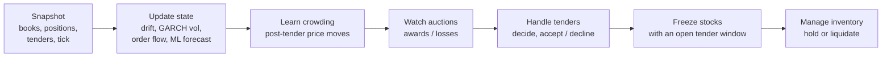
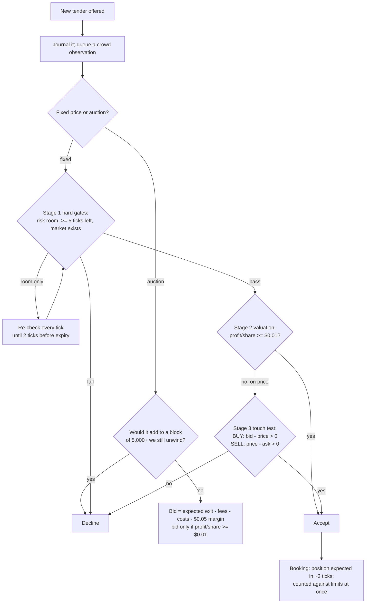
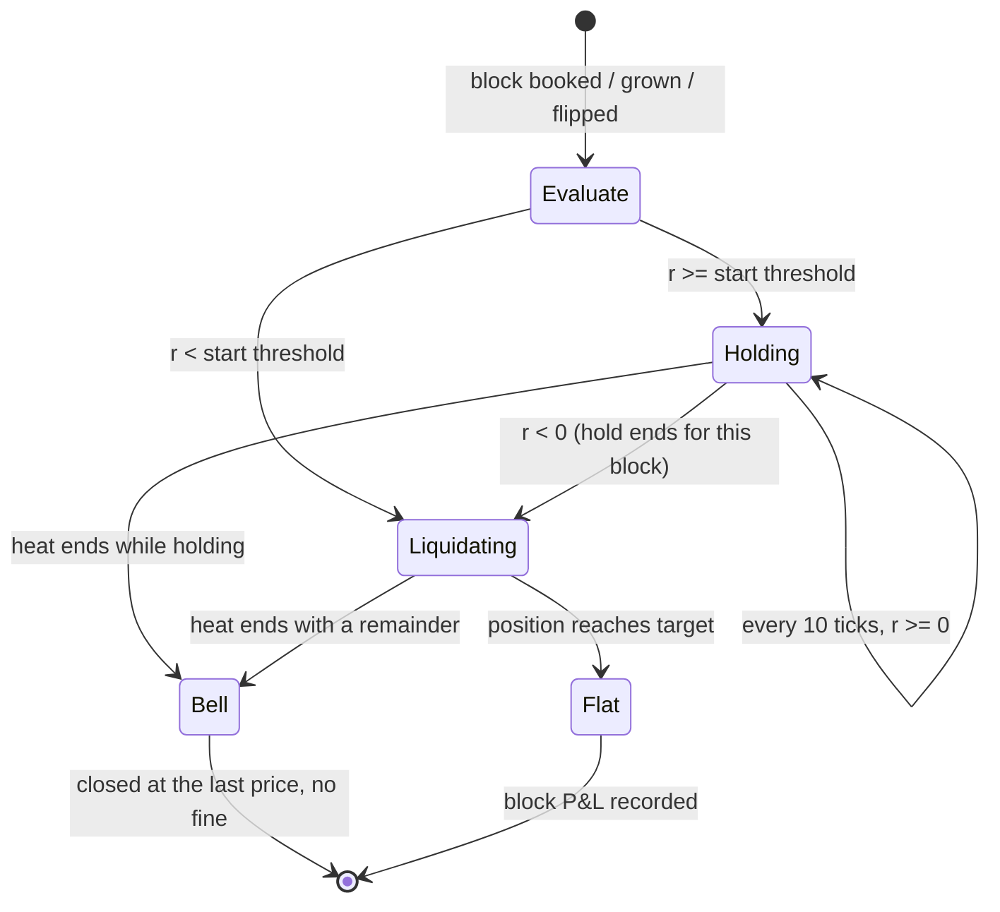

# Trend-Hold Tender Strategy (`rsi_bot`): Trading Flow

This note follows the strategy described in `docs/RSI_STRATEGY.md` step by step: how the bot moves from market data to a tender decision, then to inventory management, liquidation, and the end of the heat. Parameter values are the `rsi_bot` profile on top of `config/liquidity.toml`. Code references are to `src/ritc/strategies/liquidity.py`.

---

## 1. The control loop

The bot runs a continuous loop against the RIT REST API. A real-time feed refreshes prices and tenders every 100 ms. One pass usually takes 15-30 ms (95th percentile under 80 ms). Each pass (`step()`) runs the same seven stages in a fixed order:

| stage | what it maintains | used by |
|---|---|---|
| State update | EWMA mid drift, GARCH volatility per tick, order-flow imbalance, 10-tick ML forecast (ml_2026-10-16 v2), mid history | valuation, momentum signal, liquidation |
| Crowd learning | For each tender the desk did not take (and each auction it lost): the mid move against the implied unwind 10 ticks later, fed into a Bayesian posterior; alarm when mean > 2 sd | crowd charge, liquidation, hold start threshold |
| Auction watch | Bids still in their window, and the final awards | risk room, freezes |
| Freeze | Stocks with a tender still inside its decision window (no trading there: front-running rule) | liquidation |

## 2. Tender flow

### 2.1 Stage 1: hard gates
- **Risk room:** quantity ≤ remaining room under gross 250,000 / net 100,000 × 0.98, with pending bookings and open auction bids counted.
- **Time:** at least 5 ticks left in the heat.
- **Market:** a book to unwind into, and a stated price for a fixed tender.

A tender that fails only on room is not declined at once. It is re-evaluated every tick (`room_wait`), because blocks being liquidated and auction bids that resolve can free the room.

### 2.2 Stage 2: valuation
Profit per share is computed as if the block were liquidated at once:

  pps = side × (expected exit − tender price) − fees − drift cost − risk charge − crowd charge

| part | definition |
|---|---|
| Expected exit | Normally the touch where the unwind would rest (forward-liquidity pricing). Once the crowd alarm is on, a walk of the visible book scaled by a refill factor of 2.0. A part that offsets an existing position is valued at the touch |
| Fees | $0.02/share on the shares that must trade |
| Drift cost | adverse EWMA drift × min(unwind time, 20 ticks) |
| Risk charge | 0.3 × GARCH volatility × √(unwind ticks) |
| Crowd charge | learned rival impact × size, applied only while the crowd alarm is on |
| Close-out option | within the last 90 ticks, the exit may be valued at the mid with no fee (the free close-out at the bell) when that is better |

### 2.3 Stage 3: touch acceptance
A fixed tender declined **on price only** is accepted if its price beats the current touch (`accept_touch_edge = 0.0`). The Stage 2 costs assume an immediate unwind, which the hold often replaces, so this stage recovers tenders whose immediate-liquidation value is negative but whose price is still better than the executable market.

### 2.4 Booking
An accepted tender reaches the position about 1 second later. During that interval it is tracked as **pending**. Pending shares count against the limits, and the liquidation engine does not trade away a position that a pending opposite tender will offset. Trading through zero would create speculation.

## 3. Inventory flow: hold or liquidate

Each stock with a non-zero position (after pending offsets) is treated as a **block**. A new block starts when a tender books, when a tender grows the position, or when a tender flips its sign.

### 3.1 The hold decision (`trend_hold()`)
- **Signal:** *r* = *s* × (mid now − mid 10 ticks ago). Here *s* = +1 for a long block and −1 for a short block, so a positive *r* means the price moved in the block's favour.
- **Start:** at the block's first decision tick, hold if *r* ≥ θ_start: $0.00 normally, $0.05 while the crowd alarm is on.
- **Continue:** re-checked every 10 ticks. Keep holding while *r* ≥ 0.
- **Stop:** the first check with *r* < 0 ends the hold for good for this block, and liquidation starts on the same pass.
- **While holding:** no resting orders and no schedule. The position is simply carried.

### 3.2 Liquidation engine (when not holding)
Liquidation uses the standard execution engine of the default bot, made up of these layers:

| layer | rule |
|---|---|
| Horizon | target flat within (block size ÷ learned absorption rate), limited to 30-90 ticks |
| Schedule | Almgren-Chriss path from GARCH volatility, book-implied impact and risk aversion |
| Front-load | cross the first 25% of every new block at once (`front_cross = 0.25`), then rest the remainder |
| Resting | passive limit orders at the touch, re-priced each pass, sized from fresh order and position data |
| Sprint | cross (up to 35% of visible depth per pass, within $0.04 of the touch) while the ML model's predicted adverse move over the next 10 ticks exceeds the cost of crossing; return to resting below half that threshold |
| Crowd race | while the crowd alarm is on, cross the first 3 ticks of each new block |
| Catch-up | behind schedule → aggressive slices, with the VWAP kept within $0.04 of the touch |
| Freeze | no trading in a stock while one of its tenders is still in its decision window |

### 3.3 Interaction between holds and new tenders
- A held block uses limit room, so a new tender in the same direction may fail the room gate. In that case it waits under `room_wait` if we hold none of its stock.
- A new tender in the **same** stock and direction grows the block, which starts a fresh hold decision.
- A tender in the **opposite** direction offsets the block. The offset part is valued at the touch, because it never has to trade.
- Auctions that would add to a block being liquidated are skipped.

## 4. End of heat

| window | behaviour |
|---|---|
| Last 90 ticks (`close_hold_ticks`) | Liquidation only **rests** at the touch and never crosses, because the case closes any remainder at the last traded price at no cost. Before this window, resting is also preferred while the 1-sd dollar risk of holding to the bell (\|position\| × σ × √ticks left) stays within $40,000; only the excess is crossed |
| Last 5 ticks (`wind_down_ticks`) | Wind-down: no new decisions; resting orders kept, or cancelled where needed |
| Bell | Remaining positions, held blocks included, are closed by the case at the last traded price. A tender position is never speculation, so no fine applies |

## 5. Measurement and feedback

When a block reaches flat, the bot records its **block P&L** (stock P&L since the tender was accepted) against the expected value from Stage 2. It also updates two learned quantities:

- the stock's **absorption rate**, which sets future liquidation horizons;
- the **crowd posterior**, through the scheduled observations.

Every tender, decision, hold transition, order, fill and tick is written to the JSONL journal (`logs/data/`). The analysis tools and the replay used to validate the strategy read from it.

## 6. Example timeline (schematic)

| tick | event | flow |
|---|---|---|
| 25 | SELL tender, 53,000 TAME, priced above the ask; valuation −$0.01 | Stage 3 accepts → booking |
| 28 | Short block of 53,000 booked; last 10 ticks: TAME fell by $0.09 (*r* = +0.09) | **Hold** starts |
| 38 … 188 | Each 10-tick check: *r* ≥ 0 | Hold continues; no orders |
| 120 | BUY tender in CRZY, 54,000; net room left 48,000 | Room gate fails → re-checked each tick until expiry |
| 198 | Check: TAME rose by $0.04 over 10 ticks (*r* = −0.04) | Hold ends → front-load 25%, then the AC schedule rests the rest |
| ~215 | Position flat | Block P&L recorded; absorption updated |
| 330-420 | New blocks after tick 330 rest only (inside the close-out window) | Remainder closed at the last price |
